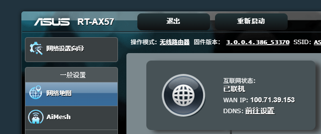

# RT-AX57 ipv6下的ipsec公网连接失败

版本3.0.0.4.386_53370，路由器与安卓设备时间是准确的

<table>
<tbody>
<tr>
<td>
RT-AX57
</td>
<td>
客户端
</td>
</tr>
<tr>
<td>
Nov  6 00:35:04 05[NET] received packet: from REDACTED_CLIENT_IPv6_A[59345] to REDACTED_SERVER_IPv6[500] (948 bytes)

Nov  6 00:35:04 05[ENC] parsed IKE_SA_INIT request 0 [ SA KE No N(NATD_S_IP) N(NATD_D_IP) N(FRAG_SUP) N(HASH_ALG) N(REDIR_SUP) ]

Nov  6 00:35:04 05[IKE] REDACTED_CLIENT_IPv6_A is initiating an IKE_SA

Nov  6 00:35:04 05[CFG] selected proposal: IKE:AES_CBC_128/HMAC_SHA2_256_128/PRF_HMAC_SHA2_256/CURVE_25519

Nov  6 00:35:04 05[IKE] remote host is behind NAT

Nov  6 00:35:04 05[IKE] DH group ECP_256 unacceptable, requesting CURVE_25519

Nov  6 00:35:04 05[ENC] generating IKE_SA_INIT response 0 [ N(INVAL_KE) V ]

Nov  6 00:35:04 05[NET] sending packet: from REDACTED_SERVER_IPv6[500] to REDACTED_CLIENT_IPv6_A[59345] (58 bytes)

Nov  6 00:35:04 07[NET] received packet: from REDACTED_CLIENT_IPv6_A[59345] to REDACTED_SERVER_IPv6[500] (916 bytes)

Nov  6 00:35:04 07[ENC] parsed IKE_SA_INIT request 0 [ SA KE No N(NATD_S_IP) N(NATD_D_IP) N(FRAG_SUP) N(HASH_ALG) N(REDIR_SUP) ]

Nov  6 00:35:04 07[IKE] REDACTED_CLIENT_IPv6_A is initiating an IKE_SA

Nov  6 00:35:04 07[CFG] selected proposal: IKE:AES_CBC_128/HMAC_SHA2_256_128/PRF_HMAC_SHA2_256/CURVE_25519

Nov  6 00:35:04 07[IKE] remote host is behind NAT

Nov  6 00:35:04 07[IKE] sending cert request for "C=TW, O=ASUS, CN=ASUS RT-AX57-8E28 Root CA"

Nov  6 00:35:04 07[ENC] generating IKE_SA_INIT response 0 [ SA KE No N(NATD_S_IP) N(NATD_D_IP) CERTREQ N(FRAG_SUP) N(HASH_ALG) N(CHDLESS_SUP) N(MULT_AUTH) V ]

Nov  6 00:35:04 07[NET] sending packet: from REDACTED_SERVER_IPv6[500] to REDACTED_CLIENT_IPv6_A[59345] (293 bytes)

Nov  6 00:35:05 06[NET] received packet: from REDACTED_CLIENT_IPv6_A[35162] to REDACTED_SERVER_IPv6[4500] (464 bytes)

Nov  6 00:35:05 06[ENC] parsed IKE_AUTH request 1 [ IDi N(INIT_CONTACT) CERTREQ IDr CPRQ(ADDR ADDR6 DNS DNS6) SA TSi TSr N(MOBIKE_SUP) N(NO_ADD_ADDR) N(MULT_AUTH) N(EAP_ONLY) N(MSG_ID_SYN_SUP) ]

Nov  6 00:35:05 06[IKE] received cert request for "C=TW, O=ASUS, CN=ASUS RT-AX57-8E28 Root CA"

Nov  6 00:35:05 06[CFG] looking for peer configs matching REDACTED_SERVER_IPv6[100.71.39.153]...REDACTED_CLIENT_IPv6_A[100.71.39.153]

Nov  6 00:35:05 06[CFG] no matching peer config found

Nov  6 00:35:05 06[IKE] peer supports MOBIKE

Nov  6 00:35:05 06[ENC] generating IKE_AUTH response 1 [ N(AUTH_FAILED) ]

Nov  6 00:35:05 06[NET] sending packet: from REDACTED_SERVER_IPv6[4500] to REDACTED_CLIENT_IPv6_A[35162] (80 bytes)
</td>
<td>
strongSwan

<a href="../logs/01_charon%281%29.log">01_charon(1).log</a>
</td>
</tr>
<tr>
<td>
:46:17 05[NET] received packet: from REDACTED_CLIENT_IPv6_B[41970] to REDACTED_SERVER_IPv6[500] (1016 bytes)

Nov  6 00:46:17 05[ENC] parsed IKE_SA_INIT request 0 [ SA KE No N(FRAG_SUP) N(HASH_ALG) ]

Nov  6 00:46:17 05[IKE] REDACTED_CLIENT_IPv6_B is initiating an IKE_SA

Nov  6 00:46:17 05[CFG] selected proposal: IKE:AES_CBC_128/HMAC_SHA2_256_128/PRF_HMAC_SHA2_256/CURVE_25519

Nov  6 00:46:17 05[IKE] DH group MODP_4096 unacceptable, requesting CURVE_25519

Nov  6 00:46:17 05[ENC] generating IKE_SA_INIT response 0 [ N(INVAL_KE) V ]

Nov  6 00:46:17 05[NET] sending packet: from REDACTED_SERVER_IPv6[500] to REDACTED_CLIENT_IPv6_B[41970] (58 bytes)

Nov  6 00:46:17 07[NET] received packet: from REDACTED_CLIENT_IPv6_B[42213] to REDACTED_SERVER_IPv6[500] (536 bytes)

Nov  6 00:46:17 07[ENC] parsed IKE_SA_INIT request 0 [ SA KE No N(FRAG_SUP) N(HASH_ALG) ]

Nov  6 00:46:17 07[IKE] REDACTED_CLIENT_IPv6_B is initiating an IKE_SA

Nov  6 00:46:17 07[CFG] selected proposal: IKE:AES_CBC_128/HMAC_SHA2_256_128/PRF_HMAC_SHA2_256/CURVE_25519

Nov  6 00:46:17 07[IKE] sending cert request for "C=TW, O=ASUS, CN=ASUS RT-AX57-8E28 Root CA"

Nov  6 00:46:17 07[ENC] generating IKE_SA_INIT response 0 [ SA KE No CERTREQ N(FRAG_SUP) N(HASH_ALG) N(CHDLESS_SUP) N(MULT_AUTH) V ]

Nov  6 00:46:17 07[NET] sending packet: from REDACTED_SERVER_IPv6[500] to REDACTED_CLIENT_IPv6_B[42213] (237 bytes)

Nov  6 00:46:17 08[NET] received packet: from REDACTED_CLIENT_IPv6_B[42213] to REDACTED_SERVER_IPv6[500] (544 bytes)

Nov  6 00:46:17 08[ENC] parsed IKE_AUTH request 1 [ IDi IDr N(MOBIKE_SUP) SA TSi TSr CPRQ(ADDR ADDR6 DNS DNS6 MASK VER) ]

Nov  6 00:46:17 08[CFG] looking for peer configs matching REDACTED_SERVER_IPv6[REDACTED_SERVER_IPv6]...REDACTED_CLIENT_IPv6_B[rongyao]

Nov  6 00:46:17 08[CFG] no matching peer config found

Nov  6 00:46:17 08[IKE] peer supports MOBIKE

Nov  6 00:46:17 08[ENC] generating IKE_AUTH response 1 [ N(AUTH_FAILED) ]

Nov  6 00:46:17 08[NET] sending packet: from REDACTED_SERVER_IPv6[500] to REDACTED_CLIENT_IPv6_B[42213] (80 bytes)
</td>
<td>
荣耀系统自带的ipsec连接，没日志
</td>
</tr>
<tr>
<td>
0:622f:1032:90bb:da2c:5b61:9f1b[500] (948 bytes)

Nov  6 00:50:45 05[ENC] parsed IKE_SA_INIT request 0 [ SA KE No N(NATD_S_IP) N(NATD_D_IP) N(FRAG_SUP) N(HASH_ALG) N(REDIR_SUP) ]

Nov  6 00:50:45 05[IKE] REDACTED_CLIENT_IPv6_B is initiating an IKE_SA

Nov  6 00:50:45 05[CFG] selected proposal: IKE:AES_CBC_128/HMAC_SHA2_256_128/PRF_HMAC_SHA2_256/CURVE_25519

Nov  6 00:50:45 05[IKE] remote host is behind NAT

Nov  6 00:50:45 05[IKE] DH group ECP_256 unacceptable, requesting CURVE_25519

Nov  6 00:50:45 05[ENC] generating IKE_SA_INIT response 0 [ N(INVAL_KE) V ]

Nov  6 00:50:45 05[NET] sending packet: from REDACTED_SERVER_IPv6[500] to REDACTED_CLIENT_IPv6_B[54028] (58 bytes)

Nov  6 00:50:45 07[NET] received packet: from REDACTED_CLIENT_IPv6_B[54028] to REDACTED_SERVER_IPv6[500] (916 bytes)

Nov  6 00:50:45 07[ENC] parsed IKE_SA_INIT request 0 [ SA KE No N(NATD_S_IP) N(NATD_D_IP) N(FRAG_SUP) N(HASH_ALG) N(REDIR_SUP) ]

Nov  6 00:50:45 07[IKE] REDACTED_CLIENT_IPv6_B is initiating an IKE_SA

Nov  6 00:50:45 07[CFG] selected proposal: IKE:AES_CBC_128/HMAC_SHA2_256_128/PRF_HMAC_SHA2_256/CURVE_25519

Nov  6 00:50:45 07[IKE] remote host is behind NAT

Nov  6 00:50:45 07[IKE] sending cert request for "C=TW, O=ASUS, CN=ASUS RT-AX57-8E28 Root CA"

Nov  6 00:50:45 07[ENC] generating IKE_SA_INIT response 0 [ SA KE No N(NATD_S_IP) N(NATD_D_IP) CERTREQ N(FRAG_SUP) N(HASH_ALG) N(CHDLESS_SUP) N(MULT_AUTH) V ]

Nov  6 00:50:45 07[NET] sending packet: from REDACTED_SERVER_IPv6[500] to REDACTED_CLIENT_IPv6_B[54028] (293 bytes)

Nov  6 00:50:45 08[NET] received packet: from REDACTED_CLIENT_IPv6_B[36512] to REDACTED_SERVER_IPv6[4500] (480 bytes)

Nov  6 00:50:45 08[ENC] parsed IKE_AUTH request 1 [ IDi N(INIT_CONTACT) CERTREQ IDr CPRQ(ADDR ADDR6 DNS DNS6) SA TSi TSr N(MOBIKE_SUP) N(NO_ADD_ADDR) N(MULT_AUTH) N(EAP_ONLY) N(MSG_ID_SYN_SUP) ]

Nov  6 00:50:45 08[IKE] received cert request for "C=TW, O=ASUS, CN=ASUS RT-AX57-8E28 Root CA"

Nov  6 00:50:45 08[CFG] looking for peer configs matching REDACTED_SERVER_IPv6[REDACTED_SERVER_IPv6]...REDACTED_CLIENT_IPv6_B[linl]

Nov  6 00:50:45 08[CFG] no matching peer config found

Nov  6 00:50:45 08[IKE] peer supports MOBIKE

Nov  6 00:50:45 08[ENC] generating IKE_AUTH response 1 [ N(AUTH_FAILED) ]

Nov  6 00:50:45 08[NET] sending packet: from REDACTED_SERVER_IPv6[4500] to REDACTED_CLIENT_IPv6_B[36512] (80 bytes)
</td>
<td>
<a href="../logs/02_charon.log">02_charon.log</a>
</td>
</tr>
</tbody>
</table>

## **四次连接实验汇总**

|  |  |  |  |  |  |  |  |  |  |
|----|----|----|----|----|----|----|----|----|----|
| # | 时间 | 客户端类型 | 客户端源 IPv6 | 服务端身份 | 客户端身份 | EAP/CERT 行为 | NAT | 失败点 | 结果 |
| 1 | 00:35 | strongSwan App（荣耀） | …:ec65:…:c7ce | 100.71.39.153（IPv4 CGNAT） | 100.71.39.153（IP，错误） | 发 EAP_ONLY+CERTREQ ✅ | 有 | no matching peer config | AUTH_FAILED |
| 2 | 00:46 | 系统自带 IPsec（荣耀） | …:4c0f:…:119a | 240e:3b0:…（IPv6） | rongyao（用户名） | 无 EAP_ONLY/CERTREQ ❌ | 无 | no matching peer config | AUTH_FAILED |
| 3 | 00:50 | strongSwan 风格（EAP） | …:4c0f:…:119a | 240e:3b0:…（IPv6） | linl（用户名） | 发 EAP_ONLY+CERTREQ ✅ | 有 | no matching peer config | AUTH_FAILED |
| 4 | 00:54 | 系统自带 IPsec（荣耀） | …:4c0f:…:119a | 240e:3b0:…（IPv6） | linl（用户名） | 无 EAP_ONLY/CERTREQ ❌ | 无 | no matching peer config | AUTH_FAILED |

## **规律与结论**

**1. 所有实验失败点完全相同。** 四次无论怎么换客户端、换身份、换认证姿势，全部死在同一行：no matching peer config found → AUTH_FAILED。IKE_SA_INIT 阶段（DH 协商、NAT 探测、加密套件）每一次都正常完成，问题永远出在 IKE_AUTH 的**对端配置匹配**上。

**2. 客户端侧变量已穷尽、全部排除。**

- 客户端身份：从错误的 IP（100.71.39.153）改成正确用户名（rongyao/linl）→ 仍失败；

- 认证方案：发 EAP_ONLY+CERTREQ（#1、#3）和不发（#2、#4）两种姿势 → 仍失败；

- 客户端软件：strongSwan App 与系统自带 IPsec → 仍失败。

- 两个完全不同行为模式的客户端（#3 和 #4）用同一用户名 linl 以**完全相同方式**失败，证明与客户端无关。

**3. 服务端身份已修好，但绑定没修好。**

- #1 时服务端身份是 IPv4 CGNAT 100.71.39.153；#2–#4 已改为 IPv6 240e:3b0:…，与接收地址一致。

- 然而改的只是"显示用 ID"，底层 **peer config 仍绑在那个 IPv4 CGNAT 外网地址上**——它从公网不可达，而你只能用 IPv6 连，于是任何落到 IPv6 接口的连接都找不到匹配配置。

**4. 根因（唯一一致因子）。** 连接全部从路由器 IPv6 240e:3b0:… 进来，而 IPSec 服务端配置绑在 IPv4 CGNAT 100.71.39.153、不服务 IPv6。这是**路由器能力/服务端绑定**问题，不是账号或客户端设置能解决。

## **下一步（不要再调客户端）**

- **首选 WireGuard**：路由器 VPN → WireGuard Server 建服务端，手机 WireGuard App 连 IPv6，绕开 IPSec 的 IPv4 绑定坑。

- **或要公网 IPv4**：向运营商申请静态公网 IP，脱离 CGNAT 后 IPv4 外网可达，IPSec 才能被匹配。

- 顺手核对：VPN 账号列表确有 linl；固件有无"绑定所有 WAN / 启用 IPv6"开关（华硕 VPN Plus 的 IPSec 历来偏 IPv4，别赌）。

**一句话：** 四次实验证明客户端已无可调之处，死因 100% 在路由器 IPSec 服务端绑在不可达的 IPv4 CGNAT、不认 IPv6——切 WireGuard 或要公网 IPv4 才能通。
